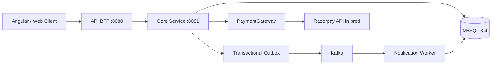

# Product Support Platform

A reference-grade backend for a **purchased-product defect and complaint portal**. Customers authenticate, view products and purchases, file defect tickets against a specific purchased order item, exchange comments with support, follow a controlled ticket lifecycle, and pay an optional quoted repair/inspection fee. The app uses Spring Boot, Java 21, MySQL, Kafka, JWT, a transactional outbox, idempotent ticket creation, and a BFF boundary.

> This is a production-oriented learning/reference implementation, not a claim of deployment-ready production certification. Before real customer traffic, complete the security, payment reconciliation, load, resilience, privacy, and operational checklist in `docs/production-readiness.md`. Local payments use a mock gateway. Live Razorpay keys are never committed.

## Architecture



- **`api-bff`**: public API facade, validates JWTs, forwards only explicit versioned routes to the core service, and keeps the internal API off the client contract.
- **`core-service`**: domain logic and data ownership for identity, catalog, orders/order items, tickets, comments, status history, service quotes, payments, idempotency and the transactional outbox.
- **`contracts`**: shared request/response and event records.
- **`notification-worker`**: consumes versioned Kafka events, deduplicates by event ID, and demonstrates notification processing with structured logs. Replace the demo delivery adapter with a real mail/SMS provider and delivery outbox before production.
- **MySQL**: schema managed by Flyway; JPA uses `ddl-auto=validate`.
- **Kafka**: asynchronous event delivery is at-least-once; consumers must remain idempotent.

## Requirements

- Java 21
- Maven 3.9+ (or install Maven; use `mvn` commands below)
- Docker Compose v2

## Run locally

1. Copy `.env.example` to `.env`. Keep these values local; do not commit `.env`.
2. Start the complete stack:

   ```bash
   docker compose up --build
   ```

3. BFF health: `http://localhost:8080/actuator/health`.
4. Core health: `http://localhost:8081/actuator/health`.
5. Swagger/OpenAPI is not exposed by default; use `docs/api-examples.md` for tested request shapes and curl examples.

To build and run tests without Docker:

```bash
mvn clean verify
```

The core application expects MySQL and Kafka to be running. For local development outside Compose, set `DB_URL`, `DB_USERNAME`, `DB_PASSWORD`, `KAFKA_BOOTSTRAP_SERVERS`, and the same `JWT_SECRET` for BFF and core. The default active profile is `local` for core and worker; it uses the mock payment provider. For real Razorpay integration, use `SPRING_PROFILES_ACTIVE=prod` and inject `RAZORPAY_KEY_ID`, `RAZORPAY_KEY_SECRET`, and `RAZORPAY_WEBHOOK_SECRET` from a secrets manager.

## Quickstart flow

1. Register a customer using `/api/v1/auth/register`, then log in.
2. To exercise catalog/order setup, first register an admin, then promote that account in a local/dev database only:

   ```sql
   UPDATE app_users SET role = 'ADMIN' WHERE email = 'admin@example.com';
-- For support operations, promote a different account:
UPDATE app_users SET role = 'SUPPORT_AGENT' WHERE email = 'support@example.com';
   ```

   Log in again to receive a token containing the updated role.
3. Use the admin token to create a product and a delivered order for the customer. The order endpoint is deliberately admin-only because this sample does not replace an e-commerce checkout/order service.
4. Log in as the customer; use `GET /api/v1/orders/me` to obtain an `orderItemId`.
5. Create a ticket with a new `Idempotency-Key`. Repeat the same request with the same key to receive the same ticket.
6. Promote a separate user to `SUPPORT_AGENT` in dev, log in as that user, and create a service quote for a ticket.
7. Customer can initiate payment for the quoted fee. Local mode returns a mock order ID; call the local-only capture endpoint to simulate `order.paid`. In production the Razorpay webhook must be configured and signature-verified.

Never promote roles via an end-user API. Role changes in this README are for a local sandbox only.

## API surface

| Method | BFF endpoint | Purpose |
|---|---|---|
| POST | `/api/v1/auth/register` | Register a customer |
| POST | `/api/v1/auth/login` | Issue a JWT |
| GET | `/api/v1/products` | List products |
| POST | `/api/v1/admin/products` | Create a product (admin) |
| POST | `/api/v1/admin/orders` | Record a delivered purchase (admin/dev integration) |
| GET | `/api/v1/orders/me` | View authenticated user's order items |
| POST | `/api/v1/tickets` | Create a defect ticket; requires `Idempotency-Key` |
| GET | `/api/v1/tickets/me` | Page through the caller's tickets |
| GET | `/api/v1/support/tickets?status=OPEN` | Support ticket queue (support/admin) |
| PATCH | `/api/v1/tickets/{id}/assignment` | Assign a ticket to an active support agent |
| GET | `/api/v1/tickets/{id}` | Fetch ticket, with ownership/support checks |
| POST | `/api/v1/tickets/{id}/comments` | Add a ticket comment |
| PATCH | `/api/v1/tickets/{id}/status` | Change status (support/admin only) |
| POST | `/api/v1/tickets/{id}/quotes` | Create a repair/inspection fee quote (support/admin) |
| GET | `/api/v1/quotes/{id}` | View an owned quote |
| POST | `/api/v1/quotes/{id}/payment` | Create a payment for a server-issued quote |
| POST | `/api/v1/webhooks/razorpay` | Verify and process payment-provider webhooks |

Internal `/internal/v1/**` endpoints are not intended for direct client access. Network isolation should make the core service private in deployed environments.

## Design decisions

- Ticket references `order_item_id`, not only `product_id`: the customer may purchase the same SKU more than once.
- The customer identity comes from a validated JWT, never from a user ID supplied in the ticket request body.
- Idempotency key is scoped to authenticated user and request payload hash; a reused key with a different payload is rejected.
- Ticket, status history, idempotency record, and outbox event are committed in one database transaction.
- Outbox publishing is at-least-once. Notification consumer stores event IDs to suppress duplicate processing.
- Payment amounts come from support-created service quotes, not from customer input. Defect ticket creation itself is free.
- Payment status is changed by a verified provider webhook. Browser redirect/query parameters are not trusted as proof of payment.
- Local profile uses `MockPaymentGateway`; it is not a live payment integration.

## License

Choose and add a license before redistributing this project.
