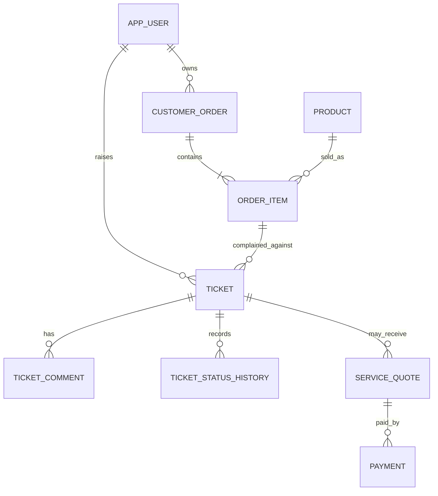

# Architecture and data model

## Domain relationships

An order item carries purchase-specific context, including who bought the item, quantity, product, and order status. Ticket creation validates ownership and eligibility server-side. This example allows more than one complaint per order item; business rules can add a uniqueness or eligibility constraint if needed.

## Request flow: create ticket

1. BFF validates the JWT signature, issuer, expiry, and roles.
2. BFF forwards the bearer token and `Idempotency-Key` to the internal core API.
3. Core resolves the caller from the token subject.
4. Core verifies that the order item belongs to the caller and the order is delivered.
5. One MySQL transaction inserts the ticket, status history, idempotency record, and outbox event.
6. The BFF returns the core response to the client.
7. The outbox publisher publishes the event to Kafka; the notification worker processes it idempotently.

## Ticket lifecycle

`OPEN -> IN_REVIEW -> WAITING_FOR_CUSTOMER -> IN_REVIEW -> RESOLVED -> CLOSED`.

`OPEN` and `IN_REVIEW` may become `REJECTED` if the complaint is ineligible. `RESOLVED` can return to `IN_REVIEW` if the defect persists. Terminal states cannot be changed through the standard state machine. Add a separate, audited reopen policy if the business needs reopening after `CLOSED`.

## Failure semantics

- Idempotency protects retries of one logical HTTP operation, not two different keys with equivalent customer intent.
- MySQL transactionality protects ticket + history + outbox from partial persistence.
- Outbox publisher may publish a duplicate if Kafka accepts the event and the publisher crashes before marking it sent. Worker deduplication is therefore required.
- Payment initiation crosses a database/provider boundary; there can be orphan provider orders on a crash. Use reconciliation/expiry jobs and provider-side reference checks before production.
- If a second provider payment is confirmed after the quote is already paid, the app records a `DuplicatePaymentCaptureDetected` event for manual/automated reconciliation; actual refund automation is not included.
- Kafka delivery is at-least-once. The demo worker logs notifications; a production sender should have its own durable delivery state, retry, dead-letter handling and provider idempotency where available.
